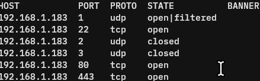

<div align="center">

# Gopher-IT 

The best networking software for you, your dog, and yo mama! It works great, feels great, and is guaranteed to make your life easier. In networking. 

</div>

## Getting Started

As of now, v1.0.1, there is a scanner binary with the scan interface, the root command, and NOTHING ELSE. The good part is the scan WORKS, unlike the last version, which, displayed the root command. Here, let's scan my 3D printer. 



See? It works just great! The default scan scrubs through 1-1024. You can test it yourself. Some of it works, some of it doesn't, but it's the core that counts, which technically works, so whatever! 

To run it, you need to turn it into an executable. In your terminal, run, 

```bash
chmod +x ./gopher-it
```

in the location you downloaded the binary. If you prefer to use Nautilus, go to the binary location, right click -> Properties -> toggle as executable as program. Then, execute it in your terminal by running

```bash
./gopher-it
```

and the root command appears. Run `./gopher-it scan` to see the scanning options. Again, it's not the full implemenation, so things are weird and wonky (IT WILL BE FIXED!!!!), but it works. 